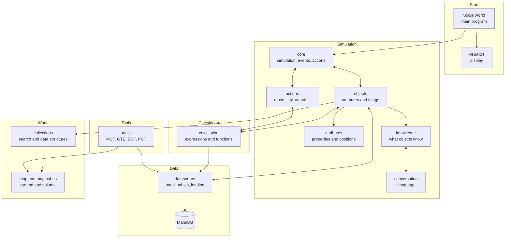
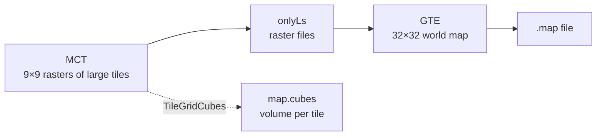

# Social World at a Glance

A simulation of living worlds: humans, animals, items and gods perceive, know, talk and act. Alongside it sits a toolbox that creates the data and landscapes they need.

| | |
|---|---|
| **Language** | Java |
| **Size** | 674 source files, about 128,000 lines |
| **Tests** | 6 test classes, mostly for the map and the cubes |
| **Database** | MariaDB |
| **User interfaces** | Swing |
| **History** | 1,513 commits since December 2007 |

> This overview was derived by script from packages, imports and class names (November 2026). The files were not read one by one, so the purpose of each package is inferred from its names and has not been checked in detail.

---

## The Map

The arrows show the strongest import relationships, not all of them.

---

## Where the Code Lives

| Area | Lines | Share | | Purpose |
|---|--:|--:|---|---|
| **`tools`** | 51,556 | 40 % | `████████████████████` | Standalone programs that create maps and data |
| **`datasource`** | 15,691 | 12 % | `██████` | Database access, pools, loading and creating objects |
| **`calculation`** | 15,359 | 12 % | `██████` | Expressions, functions and the running calculations |
| **`objects`** | 12,226 | 10 % | `█████` | The objects of the world and their states |
| **`actions`** | 6,468 | 5 % | `███` | What objects can do |
| **`attributes`** | 6,082 | 5 % | `██` | Properties, positions, perception |
| **`core`** | 5,061 | 4 % | `██` | The heartbeat of the simulation |
| **`map`** | 4,373 | 3 % | `██` | Ground properties and the volume cubes |
| **`knowledge`** | 4,273 | 3 % | `██` | What objects know |
| **`conversation`** | 2,377 | 2 % | `█` | Words, sentences, talks |
| **`collections`** | 2,373 | 2 % | `█` | Search trees and lists, also by position |
| **`visualize`** | 1,634 | 1 % | `█` | Display of the running simulation |
| **Rest** | 855 | 1 % | `▏` | `propertyChange`, `data`, main program and constants |

---

## The Simulation

**`core`** holds everything together. The names `Simulation`, `ObjectMaster`, `EventMaster` and `ActionMaster` show its three pillars: objects, events and actions.

**`objects`** describes the inhabitants of the world:

- **Animals:** down to bird orders and single species such as `Stork`, `Ostrich` or `Husky`
- **Humans and items:** clothes, food and drink
- **Special ones:** gods such as `Weather` and `Sea`, spells such as `Lightning`

Abilities are described as interfaces such as `IEatable` or `IWearable`, states as classes of their own such as `StateSeer` or `StateRunning`.

**`actions`** covers attacking, bodily functions, handling items, hearing, moving and saying.

**`knowledge`** and **`conversation`** belong closely together: what is said becomes knowledge, and knowledge becomes sentences.

## The Calculation Engine

**`calculation`** makes behaviour data-driven: descriptions define how events are perceived, how they influence properties and which reaction follows. It consists of expressions (`expressions`), functions (`functions`), descriptions (`descriptions`) and the running calculators (`application`).

## The Data

**`datasource`** is the bridge to the database:

| Part | Purpose |
|---|---|
| `mariaDB` | Connection and table foundation |
| `tablesPool`, `tablesSimulation` | The individual tables |
| `pool` | Templates and descriptions held in memory |
| `loadObjects`, `createObjects` | Loading objects and creating new ones |
| `parsing` | Reading JSON descriptions and expressions |

## The World

**`collections`** finds objects by their position and tiles by their location.

**`map`** manages ground properties such as height, inclination and material.

**`map.cubes`** represents the volume and so prepares for digging and building later: its catalog stores each tile shape once as a compact tree.

---

## The Toolbox

| Tool | Package | Lines | Purpose |
|---|---|--:|---|
| **MCT**, Map Creation Tool | `tools.mct` | 40,900 | Creates and checks tile rasters; `isles` alone has about 19,750 lines |
| **GTE**, Global Terrain Editor | `tools.glblTerrainEditor` | 6,199 | Creates and edits the large world map and its heights |
| **DCT**, Data Creation Tool | `tools.dct` | 2,835 | Creates data such as property sets and descriptions |
| **PCT**, Perception Creation Tool | `tools.pct` | 1,169 | Creates perception data |

Maps are created in several steps:

The dashed connection is prepared but not called from anywhere yet. So far the generators only produce large tiles.

---

## Entry Points

| Area | Programs with `main` |
|---|---|
| **Simulation** | `SocialWorld` |
| **MCT** | `MapCreationTool`, `MapMatchFinder`, `MapNeighbourAnalyzer`, `MapSkeletonFiller`, `MapVisualizer` |
| **GTE** | `GlobalTerrainEditor`, `GlobalTerrainGenerator`, `GlobalTerrainGenerator2` |
| **DCT** | `DataCreationTool`, `PropertySetCreationTool`, `CreationTool_EventInfluenceDescription` |
| **PCT** | `PerceptionCreationTool` |
| **Cubes** | `CubeTileDialog`, `Cube` |

---

## What Stands Out

- **The tools are bigger than the simulation.** The MCT alone makes up almost a third of all the code.
- **The simulation core is tightly interwoven.** `objects`, `calculation`, `core`, `attributes` and `datasource` import each other heavily, without clear layers.
- **`tools` is not only tooling.** `objects`, `attributes`, `actions` and `collections` import from it. `collections`, for example, uses the MCT for its tile search, and general helpers such as `ListOperations` live there too.
- **The map is still an island.** Apart from `collections`, few packages import from `map`, and `map.cubes` is only used by `TileGridCubes`.
- **The tests are young and focused.** They mostly cover the cubes and their connection to the MCT; the large rest of the project has hardly any tests.
